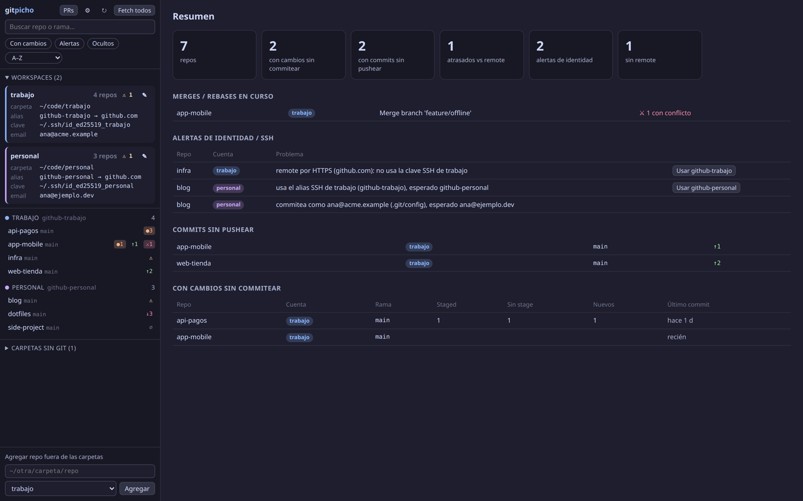

# gitpicho

**Todos tus repos git en una ventana.** Ves qué está sucio, qué falta pushear y qué repo está por pushear con la cuenta de GitHub equivocada. Y desde ahí mismo stageás por hunk, recorrés el graph, resolvés conflictos de merge y le pedís un review a Claude.

[English](README.md) · [Landing + demo](https://miguelangelrojas.dev/gitpicho)



## Para qué

Si trabajás con muchos repos y más de una cuenta de GitHub (trabajo + personal, varios clientes…):

- 30 carpetas y no sabés cuáles tienen cambios sin commitear o commits sin pushear.
- Un repo clonado con el alias SSH equivocado pushea con otra cuenta. Un `includeIf` que falta commitea con otro email.
- Saltás entre terminal, lazygit, VS Code y GitHub para sacar un PR.

gitpicho escanea las carpetas que le digas ("workspaces"), lista todos los repos y te avisa cuando algo no coincide con la identidad que espera ese workspace.

## Qué hace

- **Resumen multi-repo**: con cambios, sin pushear, atrasados, sin remote, merges en curso. Detecta worktrees y repos anidados.
- **Chequeo de identidad por workspace**: alias SSH esperado (`Host` de `~/.ssh/config`) y `user.email` esperado (de un gitconfig). Arreglo de un click que cambia solo el host del remote.
- **Cambios**: stage/unstage/descartar por archivo *y por hunk*, amend, commit con la salida de los hooks en vivo (husky, lint-staged…) y cancelable.
- **Historial**: graph de commits, click en la rama para cambiarte, checkout detached, crear rama desde cualquier commit.
- **Merge y conflictos**: merge de cualquier rama, resolución bloque por bloque (mío / de ellos / ambos / editar), abortar o terminar merge, rebase, cherry-pick y revert.
- **Fetch / pull (`--ff-only`) / push** con la clave SSH de cada repo, sin prompts (falla rápido en vez de colgarse).
- **Claude** (opcional, requiere [Claude Code](https://docs.claude.com/en/docs/claude-code)):
  - 3 mensajes de commit para lo staged, en el estilo de tus últimos commits.
  - Descripción de PR (`## Problema` / `## Solución`) contra la rama base detectada.
  - **Review** de la rama en solo lectura: hallazgos con `archivo:línea`, tipo y comentario listo para pegar en el PR. Puede leer una carpeta de notas (por ejemplo un vault de Obsidian con reglas de negocio). Los reviews quedan guardados.
  - Abrir `claude` en una terminal dentro del repo, con el perfil de Claude del workspace.
- **Pull requests** (opcional, requiere [`gh`](https://cli.github.com)): PRs donde te piden review, asignados o tuyos, vinculados al clon local. "Checkout + Review" en un click.
- Una cuenta de `gh` y un perfil de Claude **por workspace**: trabajo y personal no se mezclan.

## Instalar

Requisitos: **git** y **Node.js 20+**. Probado en Linux. macOS debería funcionar pero está sin probar; Windows todavía no.

```bash
git clone https://github.com/gregorioafk/gitpicho.git
cd gitpicho
npm install          # o: bun install / pnpm install
./gitpicho           # app de escritorio (Electron)
```

¿Preferís el navegador? `./gitpicho --web` (o `node server.js`) en <http://localhost:7777>. Solo escucha en `127.0.0.1`.

Extras en Linux:

```bash
scripts/install-desktop.sh     # comando `gitpicho` en ~/.local/bin + acceso en el menú
scripts/install-apparmor.sh    # Ubuntu 23.10+: Electron con sandbox (si no, arranca con --no-sandbox)
```

## Primer arranque: agregá un workspace

Abrí la app → **+ Agregar workspace** (después, desde el botón ⚙).

| Campo | Obligatorio | Para qué |
| --- | --- | --- |
| Nombre | sí | Etiqueta en la barra lateral (`trabajo`, `personal`, `cliente-x`). |
| Carpeta | sí | Carpeta que contiene tus repos (ej. `~/code/trabajo`). Un repo suelto también sirve. |
| Alias SSH esperado | no | `Host` de `~/.ssh/config` que deberían usar los remotes (ej. `github-trabajo`). |
| gitconfig de la cuenta | no | Archivo con el `user.email` esperado (ej. `~/.gitconfig-trabajo`). |
| Perfil de Claude | no | `CLAUDE_CONFIG_DIR` para este workspace. |
| Carpeta de notas | no | Docs o vault que Claude lee (solo lectura) en los reviews. |
| Config de gh | no | `GH_CONFIG_DIR` con la cuenta de GitHub de este workspace. |

Los repos que estén fuera de un workspace se agregan de a uno desde la barra lateral.

¿Querés probar con datos de mentira?

```bash
scripts/demo.sh /tmp/gitpicho-demo
HOME=/tmp/gitpicho-demo/home node server.js   # http://localhost:7777
```

## Varias cuentas de GitHub, versión corta

```sshconfig
# ~/.ssh/config
Host github-trabajo
  HostName github.com
  IdentityFile ~/.ssh/id_ed25519_trabajo
Host github-personal
  HostName github.com
  IdentityFile ~/.ssh/id_ed25519_personal
```

```ini
# ~/.gitconfig
[includeIf "gitdir:~/code/trabajo/"]
  path = ~/.gitconfig-trabajo     # [user] email = vos@empresa.com
[includeIf "gitdir:~/code/personal/"]
  path = ~/.gitconfig-personal    # [user] email = vos@personal.dev
```

Cloná con `git@github-trabajo:org/repo.git`. gitpicho avisa si un repo de `~/code/trabajo` usa otro alias, `github.com` pelado, HTTPS u otro email, y ofrece **Usar github-trabajo** para corregir el remote.

Otra cuenta de GitHub CLI: `GH_CONFIG_DIR=~/.config/gh-trabajo gh auth login` y poné esa carpeta en el workspace.

## Configuración

Se guarda en `~/.config/gitpicho/config.json` (o `GITPICHO_CONFIG=/ruta/config.json`). Todo se edita desde la UI; ver [`config.example.json`](config.example.json) y [docs/config.md](docs/config.md).

## Seguridad

- Escucha solo en `127.0.0.1`, valida el header `Host` (DNS rebinding) y exige un header propio en cada POST (CSRF).
- Corre `git` con `execFile` (nunca shell), `GIT_TERMINAL_PROMPT=0` y SSH con `BatchMode=yes`.
- De `~/.ssh/config` solo lee qué clave usa cada host; nunca el contenido de las claves.
- Claude corre sin herramientas para textos de commit/PR, y con herramientas de solo lectura (`Read`, `Grep`, `Glob`) acotadas al repo (+ notas) para los reviews.

## Contribuir

Issues y PRs bienvenidos. Sin build ni framework: `server.js` (Node, cero dependencias), `public/app.js` (JS plano), `main.js` (ventana Electron). Corré `node server.js` y recargá el navegador mientras trabajás. `scripts/demo.sh` te arma un sandbox con todos los estados posibles.

## Licencia

[MIT](LICENSE)
