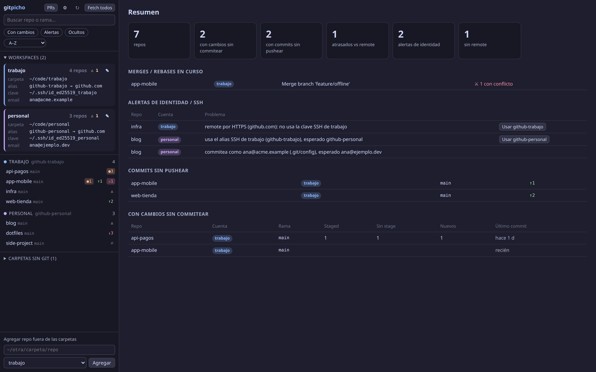

# gitpicho

**All your git repos in one window.** See what's dirty, what's not pushed and which repo is about to push with the wrong GitHub account — then stage by hunk, browse the graph, resolve merge conflicts and get a code review from Claude, without leaving the app.

[Español](README.es.md) · [Landing + demo](https://miguelangelrojas.dev/gitpicho)



> The UI is in Spanish (for now). Everything else — git, SSH, your editor — works as usual.

## Why

If you work with many repos and more than one GitHub account (work + personal, several clients…), you know the pain:

- 30+ folders, and no idea which ones have uncommitted work or unpushed commits.
- A repo cloned with the wrong SSH alias pushes as the wrong account. A missing `includeIf` commits with the wrong email.
- Switching between terminal, lazygit, VS Code and the GitHub tab just to ship one PR.

gitpicho scans the folders you tell it ("workspaces"), shows every repo in a sidebar, and tells you when something doesn't match the identity that workspace expects.

## Features

- **Multi-repo dashboard** — dirty repos, unpushed commits, behind remote, repos without remote, merges in progress. Detects worktrees and nested repos.
- **Identity checks per workspace** — expected SSH alias (`Host` in `~/.ssh/config`) and expected `user.email` (from a gitconfig file). One-click fix that rewrites only the remote host.
- **Changes** — stage/unstage/discard per file *and per hunk*, amend, commit with live hook output (husky, lint-staged…) and cancel.
- **History** — commit graph, click a branch badge to switch, checkout detached, create branch from any commit.
- **Merge & conflicts** — merge any local/remote branch, resolve block by block (mine / theirs / both / edit), abort or continue merge, rebase, cherry-pick, revert.
- **Fetch / pull (`--ff-only`) / push** with each repo's own SSH key, never prompting (fails fast instead of hanging).
- **Claude** (optional, needs [Claude Code](https://docs.claude.com/en/docs/claude-code)):
  - 3 commit message suggestions from the staged diff, in the style of your last commits.
  - PR description (`## Problem` / `## Solution`) against the detected base branch.
  - Read-only **code review** of the branch: findings with `file:line`, type and a comment ready to paste in the PR. Can read a notes folder (e.g. an Obsidian vault with business rules) for context. Reviews are saved locally.
  - Open `claude` in a terminal inside the repo, with the workspace's own Claude profile.
- **Pull requests** (optional, needs [`gh`](https://cli.github.com)) — PRs where your review is requested, assigned or authored, linked to the local clone. "Checkout + Review" in one click.
- One `gh` account and one Claude profile **per workspace**, so work and personal never mix.

## Install

Requirements: **git**, **Node.js 20+**. Tested on Linux. macOS should work but is untested; Windows is not supported yet.

```bash
git clone https://github.com/gregorioafk/gitpicho.git
cd gitpicho
npm install          # or: bun install / pnpm install
./gitpicho           # desktop app (Electron)
```

Prefer the browser? `./gitpicho --web` (or `node server.js`) serves it on <http://localhost:7777>. The server only listens on `127.0.0.1`.

Linux extras:

```bash
scripts/install-desktop.sh     # `gitpicho` command in ~/.local/bin + app menu entry
scripts/install-apparmor.sh    # Ubuntu 23.10+: lets Electron use its sandbox (otherwise it runs with --no-sandbox)
```

## First run: add a workspace

Open the app → **+ Agregar workspace** (or the ⚙ button later).

| Field | Required | What it does |
| --- | --- | --- |
| Name | yes | Label shown in the sidebar (`work`, `personal`, `client-x`). |
| Folder | yes | Folder that contains your repos (e.g. `~/code/work`). A single repo also works. |
| Expected SSH alias | no | `Host` from `~/.ssh/config` remotes should use (e.g. `github-work`). |
| Account gitconfig | no | File with the expected `user.email` (e.g. `~/.gitconfig-work`). |
| Claude profile | no | `CLAUDE_CONFIG_DIR` to use in this workspace. |
| Notes folder | no | Docs/vault Claude reads (read-only) during reviews. |
| gh config | no | `GH_CONFIG_DIR` for this workspace's GitHub account. |

Repos outside any workspace can be added one by one from the sidebar.

Want to try it with fake data first?

```bash
scripts/demo.sh /tmp/gitpicho-demo
HOME=/tmp/gitpicho-demo/home node server.js   # http://localhost:7777
```

## Multiple GitHub accounts, the short version

```sshconfig
# ~/.ssh/config
Host github-work
  HostName github.com
  IdentityFile ~/.ssh/id_ed25519_work
Host github-personal
  HostName github.com
  IdentityFile ~/.ssh/id_ed25519_personal
```

```ini
# ~/.gitconfig
[includeIf "gitdir:~/code/work/"]
  path = ~/.gitconfig-work        # [user] email = you@company.com
[includeIf "gitdir:~/code/personal/"]
  path = ~/.gitconfig-personal    # [user] email = you@personal.dev
```

Clone with `git@github-work:org/repo.git`. gitpicho warns if a repo under `~/code/work` uses another alias, plain `github.com`, HTTPS, or commits with another email — and offers **Usar github-work** to fix the remote.

More GitHub CLI accounts: `GH_CONFIG_DIR=~/.config/gh-work gh auth login`, then set that folder in the workspace.

## Configuration

Stored in `~/.config/gitpicho/config.json` (override with `GITPICHO_CONFIG=/path/config.json`). Everything is editable from the UI; see [`config.example.json`](config.example.json) and [docs/config.md](docs/config.md).

## Security

- Listens on `127.0.0.1` only, checks the `Host` header (DNS rebinding) and requires a custom header on every POST (CSRF).
- Runs `git` with `execFile` (never a shell), `GIT_TERMINAL_PROMPT=0` and SSH `BatchMode=yes`.
- Reads `~/.ssh/config` only to show which key a host uses; never reads key contents.
- Claude runs with no tools for commit/PR text, and with read-only tools (`Read`, `Grep`, `Glob`) limited to the repo (+ notes folder) for reviews.

## Contributing

Issues and PRs welcome. No build step, no frontend framework: `server.js` (Node, zero deps), `public/app.js` (vanilla JS), `main.js` (Electron shell). Run `node server.js` and reload the browser while you work. Use `scripts/demo.sh` to get a sandbox with every repo state.

## License

[MIT](LICENSE)
